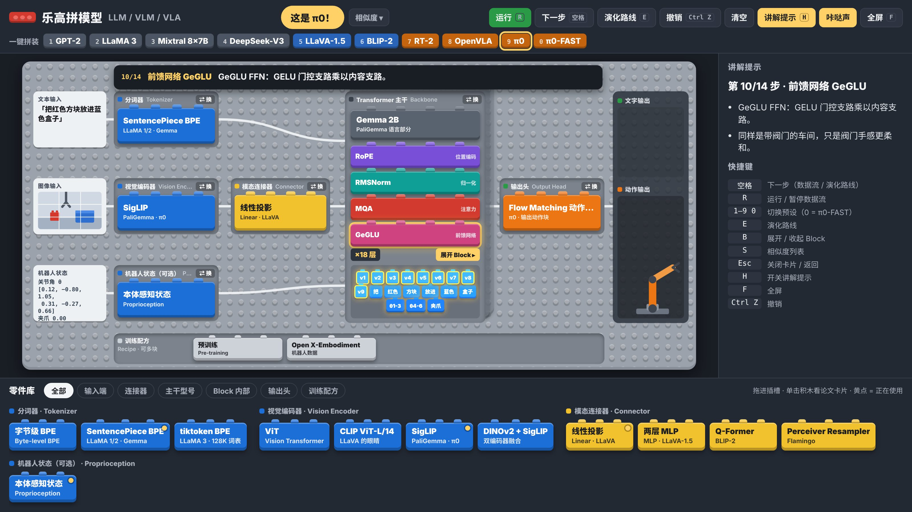
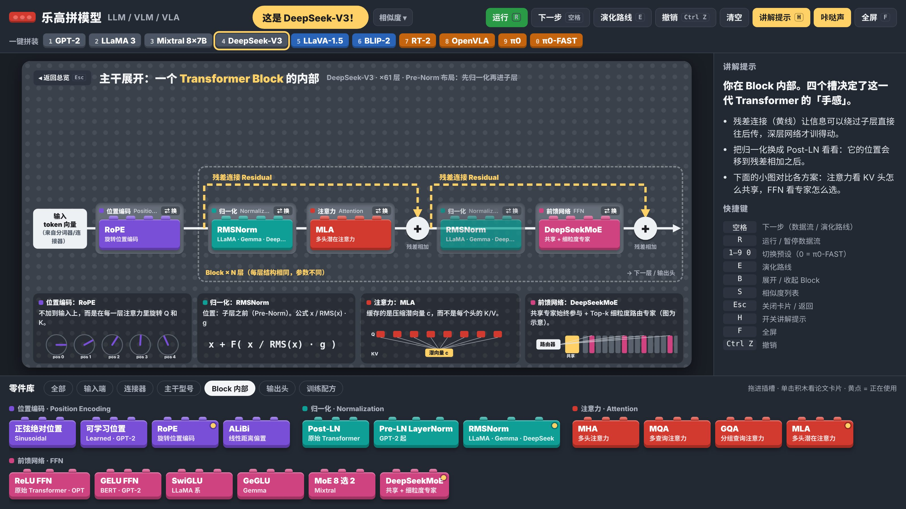

# 乐高拼模型：LLM / VLM / VLA

用乐高积木的方式讲清楚大语言模型、视觉语言模型和视觉-语言-动作模型是怎么拼起来的。一个 HTML 文件，双击就能打开，适合组会汇报时边操作边讲。



## 能做什么

- **拼装**：中间灰色底板是 Transformer 主干，左边是输入端（文字、图像、机器人状态），右边是输出端（文字或动作）。从零件库把积木拖进插槽，类型不对的插不进去。
- **展开 Block**：点主干上的「展开 Block」，进入一个 Transformer Block 内部，换位置编码、归一化、注意力、FFN，能看到残差连接的走线。
- **论文卡片**：点任意积木，弹出论文名、年份、机构、核心思想、解决的问题、生活化比喻和 arXiv 链接。
- **数据流动画**：文字变成 token，图像切成 patch，依次流过每个插槽，每一步都有说明，最后输出文字或让机械臂动起来。可以按空格一步一步讲。
- **识别模型**：拼出预设结构时显示「这是 LLaVA-1.5！」，差几块时显示「接近 OpenVLA」并列出差异。按 S 打开和所有预设的相似度排序。
- **演化路线**：GPT-2 → LLaMA 3 → LLaVA-1.5 → OpenVLA → π0，每一步只换变化的积木，并高亮这次换了什么。



## 内置预设

| 按键 | 模型 | 类型 |
| --- | --- | --- |
| 1 | GPT-2 | LLM |
| 2 | LLaMA 3 | LLM |
| 3 | Mixtral 8x7B | LLM |
| 4 | DeepSeek-V3 | LLM |
| 5 | LLaVA-1.5 | VLM |
| 6 | BLIP-2 | VLM |
| 7 | RT-2 | VLA |
| 8 | OpenVLA | VLA |
| 9 | π0 | VLA |
| 0 | π0-FAST | VLA |


## 技术发展脉络

点击页面顶部的「知识脉络」可浏览独立知识图谱，覆盖 LLM、VLM 上游、VLA 与下游部署/评测/产业四个层级。支持关键词搜索、层级与主题筛选，以及节点间的技术继承和相关关系跳转。知识节点数据独立保存在 `data/knowledge-data.js`，便于后续持续扩展；原有乐高拼装和预设模型功能保持独立。

## 使用

直接用浏览器打开 `index.html`，不需要安装任何东西。字体从 Google Fonts 加载，断网时会换成系统字体，不影响功能。

也可以开启 GitHub Pages（Settings → Pages → 分支选 `main`、目录选 `/ (root)`），得到一个在线地址。

### 快捷键

| 按键 | 作用 |
| --- | --- |
| 空格 | 下一步（数据流 / 演化路线） |
| R | 运行 / 暂停数据流 |
| 1–9、0 | 切换预设 |
| E | 演化路线 |
| B | 展开 / 收起 Block |
| S | 相似度列表 |
| H | 开关讲解提示面板 |
| F | 全屏 |
| Esc | 关闭卡片 / 返回 |
| Ctrl+Z | 撤销 |

## 加新论文

所有积木、插槽和预设都写在 `index.html` 顶部的 JSON 配置里，加论文不用改代码。字段说明和示例见 [docs/CONFIG.md](docs/CONFIG.md)。

改完后运行检查脚本（只需要 Python 3，没有其他依赖）：

```bash
python3 tools/validate_config.py
```

## 关于内容准确性

论文年份、机构和结构细节是按公开资料整理的。不确定的字段在配置里用 `verify` 标出，卡片上会显示「待核实」。发现错误欢迎提 issue。

图示做了简化：比如数据流里图像只切成 9 个 patch，MoE 专家数量也只是示意。真实数量写在论文卡片和讲解提示里。

## 目录结构

```
index.html                 页面本体，配置在文件顶部
docs/CONFIG.md             配置字段说明
docs/screenshot-*.jpg      README 截图
tools/validate_config.py   配置检查脚本
```

## 许可

[MIT](LICENSE)
